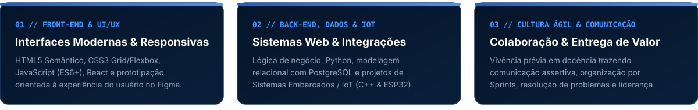

  

   

  
  
  
  

---

## 👨‍💻 Sobre Mim

Olá! Sou **Italo Holanda Neves**, desenvolvedor de software residente em **Manaus, AM**, focado na construção de interfaces web modernas, sistemas interativos e soluções digitais centradas na experiência do usuário (**UI/UX**).

- 🎓 **Formação Técnica:** Graduando em **Análise e Desenvolvimento de Sistemas** pela **Faculdade de Tecnologia Senac Amazonas**.
- 💼 **Atuação Prática:** Desenvolvedor Web voluntário no **IDESAM** (*Instituto de Conservação e Desenvolvimento Sustentável da Amazônia*), contribuindo em soluções digitais para impacto socioambiental.
- 🤝 **Diferencial Humano & Ágil:** Também sou licenciado em Educação Física (**Fametro**) com atuação prévia na **SEMED Manaus**. Essa trajetória consolidou competências essenciais para a Engenharia de Software: **comunicação assertiva, didática técnica, trabalho em equipe, organização por Sprints e foco em resultados**.

  

---

## 🛠️ Tecnologias, Ferramentas & Idiomas

### Front-End & Design de Interfaces

### Back-End, Banco de Dados & Sistemas Embarcados (IoT)

### Ecossistema, Deploy & Idiomas

---

## 🚀 Vitrine de Projetos em Destaque

Confira abaixo os principais sistemas e aplicações publicados no meu portfólio e aqui no GitHub:

| Projeto | Categoria | Tecnologias Principais | Acesso Rápido |
| :--- | :--- | :--- | :---: |
| 💻 **[Portfólio Profissional](https://github.com/italoholanda-dev/portfolio)** Site oficial com Design System autoral, Scroll Spy, animações com Intersection Observer e responsividade multi-telas. | **Front-End & UI/UX** | `HTML5` `CSS3` `JavaScript` `SVG` | [🌐 Deploy](https://portfolio-italo-murex.vercel.app/) · [📂 Código](https://github.com/italoholanda-dev/portfolio) |
| 🏃‍♂️ **[Associação Atlética de Manaus (AAM)](https://github.com/italoholanda-dev/associacao-atletica-de-manaus)** Plataforma oficial de corridas de rua de Manaus (42K, 21K, 10K e 5K) com cronômetro regressivo em tempo real, mapas integrados, inscrições e voluntariado. | **Aplicação Web** | `HTML5` `CSS3` `JavaScript` `PostgreSQL` | [🌐 Deploy](https://site-corridas-aam.vercel.app/) · [📂 Código](https://github.com/italoholanda-dev/associacao-atletica-de-manaus) |
| 📊 **[Calculadora de Impostos CLT vs. PJ](https://github.com/italoholanda-dev/calculadora-impostos)** Simulador financeiro interativo comparando descontos progressivos de INSS, IRRF e FGTS (CLT) com Simples Nacional e Lucro Presumido (PJ). | **Front-End & Regras de Negócio** | `HTML5` `CSS3` `JavaScript` | [🌐 Deploy](https://calculadora-impostos-3gft.vercel.app/) · [📂 Código](https://github.com/italoholanda-dev/calculadora-impostos) |
| 🤖 **[Controle IoT de Servo Motor (ESP32)](https://github.com/italoholanda-dev/servo-motor-esp32)** Sistema embarcado para acionamento remoto via Wi-Fi com microcontrolador ESP32, nuvem Blynk IoT e simulação de hardware no Wokwi. | **IoT & Sistemas Embarcados** | `C++` `ESP32` `PlatformIO` `Blynk` | [▶️ Wokwi](https://wokwi.com/projects/463772772856028161) · [📂 Código](https://github.com/italoholanda-dev/servo-motor-esp32) |
| 🌿 **Floresta ID — Plataforma Digital** Sistema Full-Stack voltado à rastreabilidade e soluções digitais para a região amazônica. | **Full-Stack** | `PostgreSQL` `JavaScript` `HTML5` `CSS3` | *Em desenvolvimento* |

---

## 📈 Trajetória Acadêmica & Profissional

| Período | Instituição / Organização | Atuação / Formação |
| :---: | :--- | :--- |
| **2026 — Atual** | **IDESAM** *(Instituto de Conservação e Desenvolvimento da Amazônia)* | 💻 **Desenvolvedor Web** *(Voluntariado)* |
| **2026 — Atual** | **Faculdade de Tecnologia Senac Amazonas** | 🎓 **Graduação em Análise e Desenvolvimento de Sistemas (ADS)** |
| **2024 — 2025** | **SEMED Manaus** *(Secretaria Municipal de Educação)* | 🏆 **Instrutor de Práticas Esportivas** *(Liderança, Didática e Gestão de Grupos)* |
| **2023** | **Centro Universitário Fametro** | 🎓 **Licenciatura em Educação Física** |

---

## 📬 Vamos Conversar?

Estou sempre aberto a novas oportunidades em **Desenvolvimento Front-End / Full-Stack**, colaborações em projetos e conexões com profissionais da área de tecnologia:

- 🌐 **Portfólio Online:** [portfolio-italo-murex.vercel.app](https://portfolio-italo-murex.vercel.app/)
- 💼 **LinkedIn:** [linkedin.com/in/italo-holanda](https://www.linkedin.com/in/italo-holanda/)
- 📧 **E-mail:** [italoholanda90@gmail.com](mailto:italoholanda90@gmail.com)
- 📱 **Telefone / WhatsApp:** (92) 99422-7050

   
  Desenvolvido com dedicação por <b>Italo Holanda Neves</b> • Manaus, Amazonas 🇧🇷

